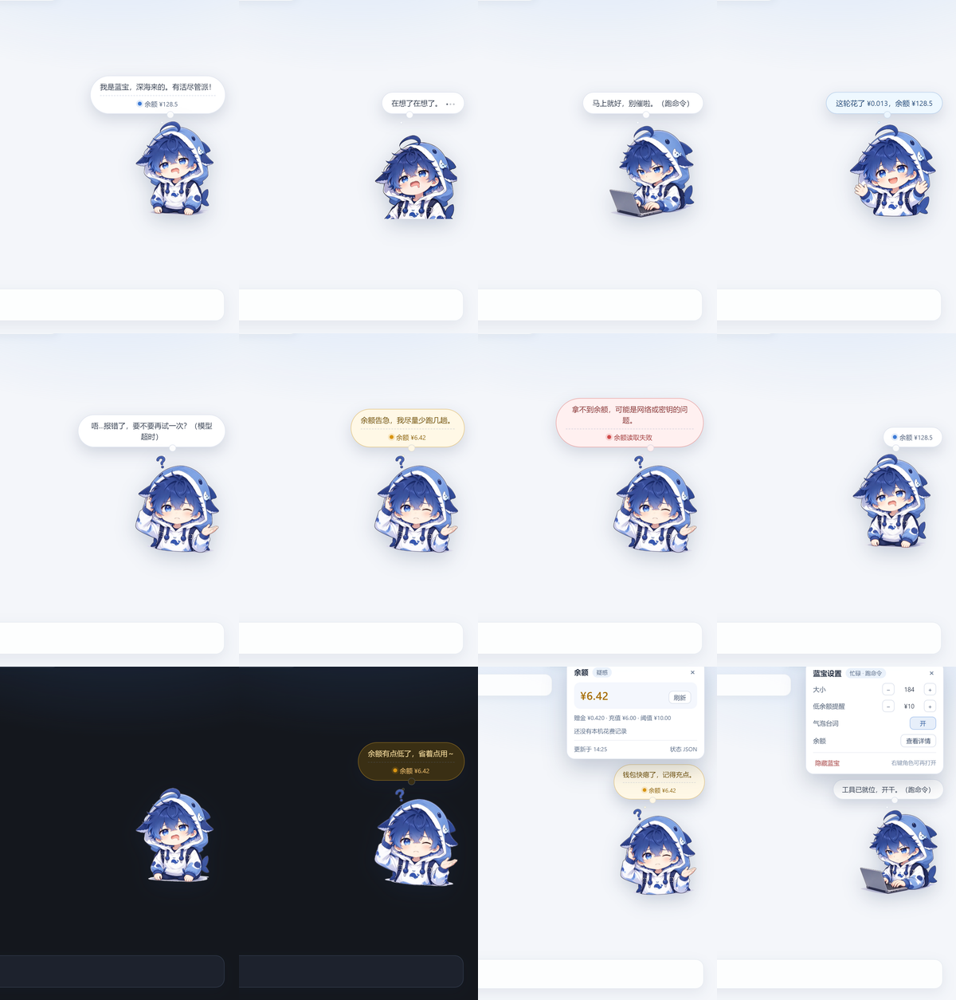
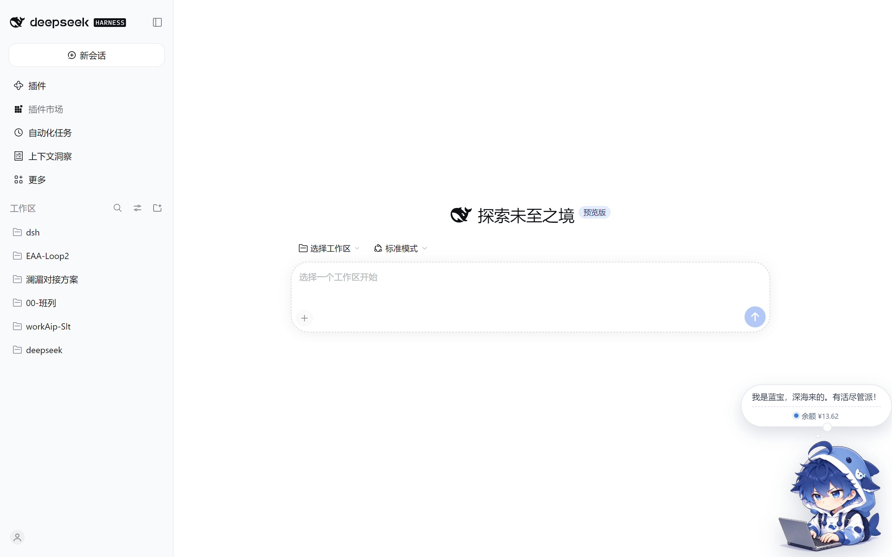
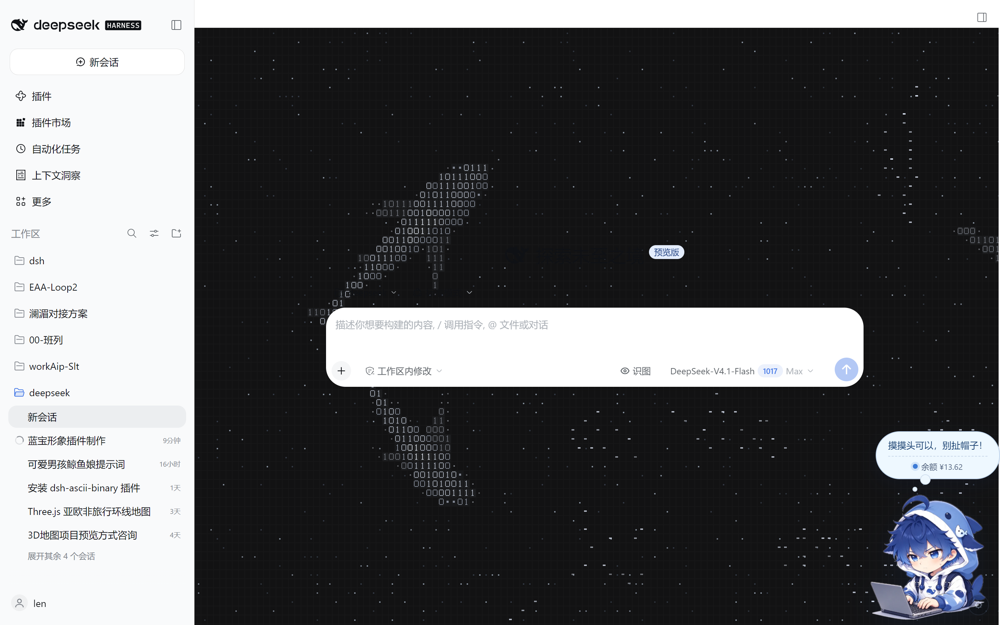
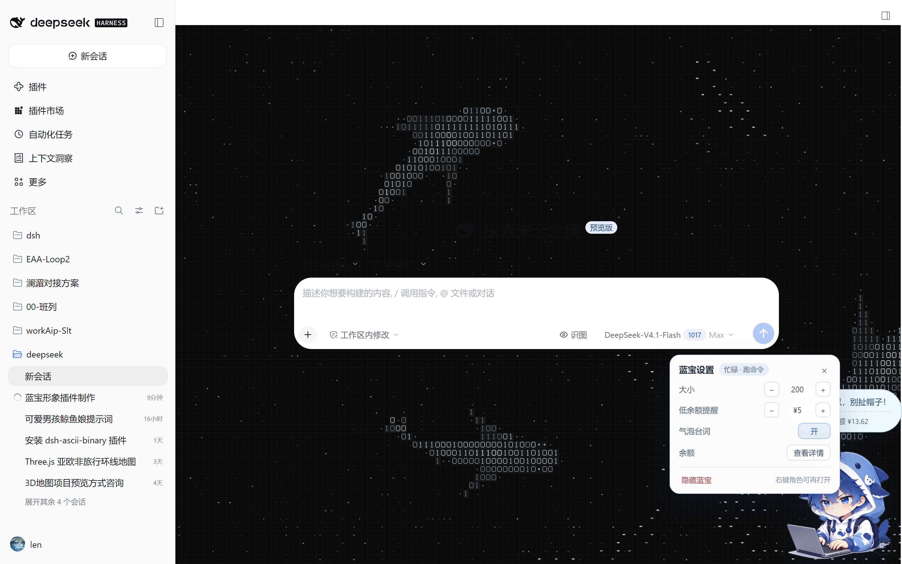

# dsh-lanbao-widget（蓝宝挂件）

[DeepSeek Harness](https://github.com/deepseek-ai/deepseek-harness)（DSH）Web 界面右下角的角色挂件：
把「蓝宝」——深海蓝发、鲨鱼兜帽的小男孩——挂到页面角落，**按情境切换表情和台词，并提示 DeepSeek 余额**。

> A mascot widget for the DSH Web UI: switches among five expressions (idle / thinking / busy / happy /
> confused) based on live session events, comments on what it is doing, and keeps an eye on your DeepSeek
> balance — with low-balance warnings and a per-turn cost readout.









角色设定（配色、发型、鲨鱼帽鳍等）见 [`docs/design-sheet.jpg`](docs/design-sheet.jpg)。

---

## 一、它在什么情况下是什么表情

| 情境 | 判定依据 | 表情 | 台词举例 |
|---|---|---|---|
| 待机 | 没有进行中的回合 | 待机 | 「待机中…要不要派点活给我？」 |
| 思考 | 有回合在跑，模型在生成 | 思考 | 「让我想想……」「脑内小鲨鱼正在加速。」 |
| 忙碌 | 有工具调用未返回 | 忙碌 | 「正在搬砖…搬代码。（跑命令）」 |
| 开心 | 回合正常结束 | 开心 | 「搞定！要不要检查一下？」 |
| 疑惑 | 回合失败 / 工具报错 / 被中断 / 余额见底 | 疑惑 | 「诶？好像出错了…」 |

优先级从高到低：**忙碌 → 思考 → 瞬时表情（开心/疑惑，几秒）→ 余额告急 → 待机**，
所以正在跑工具时不会被"上一轮成功了"的开心盖掉。

判定靠宿主侧的会话事件（`turn/start`、`tool/call`、`tool/result`、`turn/end` 等），不扒 DOM。

### 气泡与交互

蓝宝头顶是一颗**椭圆气泡**，平时完全不显示（不占视觉、也不挡鼠标）。
它只在这几种时候出现：

- **点一下角色** —— 摸摸头，顺便把余额报给你；
- **随机冒泡** —— 空闲时每 3~8 分钟自己亮一次余额；
- **对话跑完** —— 报一句「这轮花了多少、还剩多少」；
- 情境台词（思考 / 忙碌 / 出错）和余额告警（偏低 / 见底 / 读不到）。

| 操作 | 效果 |
|---|---|
| 左键点角色 | 「开心」+ 说一句 + **显示余额** |
| 点气泡 | 打开**余额详情**：余额、赠金、充值、阈值、上轮花费、刷新按钮 |
| 右击角色 | 打开**设置菜单**：大小、低余额提醒、气泡台词、余额详情、隐藏蓝宝 |
| 拖住角色 | 换位置，自动记住 |
| 长按角色（触屏） | 同右击 |
| Esc / 点空白 | 关掉弹层 |

## 二、余额提示怎么工作

| 余额状态 | 判定 | 表现 |
|---|---|---|
| 正常 | 余额 ≥ 阈值 | 蓝点 + `余额 ¥xxx`（点角色 / 随机 / 回合结束时出现） |
| 偏低 | 0 < 余额 < 阈值 | 琥珀色点 + 气泡变琥珀 + 台词「余额有点低了，省着点用～」 |
| 见底 | 余额为 0 | 红点 + 蓝宝一直「疑惑」+「余额见底了！先充点吧。」 |
| 读取失败 | 网络 / HTTP / 返回结构异常 | 红点 + 气泡显示「余额读取失败」，并保留上一次数值（标注「缓存」） |
| 未配置密钥 | 找不到 `DEEPSEEK_API_KEY` | 灰点 + `余额 —`，**不会**一直苦着脸 |

余额走 DSH 自己的凭据服务（`ctx.credentials.resolve('DEEPSEEK_API_KEY')`），接口是
`https://api.deepseek.com/user/balance`；密钥只留在宿主进程，绝不下发到页面。

缓存 60 秒；自动刷新（回合结束）最小间隔 15 秒，手动「刷新」最小间隔 3 秒。
每轮花费 = 回合开始前的余额 − 回合结束后的余额。

## 三、安装

```powershell
# 本地目录（推荐开发时用，改代码刷新即生效）
dsh plugin --profile web add link:D:\develp\test\dsh-lanbao-widget
```

也可以手动改 profile：把包名加进 `%USERPROFILE%\.dsh\profiles\web\package.json` 的
`dsh.profile.bundles`，依赖写成 `"dsh-lanbao-widget": "link:<目录>"`，
然后在 profile 目录跑一次 `pnpm install`。

装完刷新页面即可。**不需要重启 `dsh web`** —— profile 的 `patchReload: live` 会热加载。

卸载：

```powershell
dsh plugin --profile web remove dsh-lanbao-widget
```

### 装完文件到底在哪

以 `link:` 方式安装时，代码只有一份，profile 里只是一个链接目录：

| 位置 | 作用 |
|---|---|
| `D:\develp\test\dsh-lanbao-widget\` | **唯一源码目录**，所有改动都在这里 |
| `%USERPROFILE%\.dsh\profiles\web\node_modules\dsh-lanbao-widget` | 指向上面的 **junction 链接**（不是拷贝，改源码立即生效） |
| `%USERPROFILE%\.dsh\profiles\web\package.json` | 依赖声明 + `dsh.profile.bundles` 里加了一行 |
| `%USERPROFILE%\.dsh\lanbao-widget.json` | 运行时设置（大小、位置、阈值），由面板写入 |
| `%USERPROFILE%\.dsh\profiles\web\pnpm-lock.yaml` | pnpm 更新了 lock |

换成从 npm 安装时，代码会被真正拷到 `node_modules/dsh-lanbao-widget/`，那时更新需要重装。

## 四、配置

改 profile 的 `cordis.patch.yml` 里 `lanbao-widget` 那段 `config`，或者点页面上的余额胶囊打开面板
（面板改的会写回 `%USERPROFILE%\.dsh\lanbao-widget.json`）。

| 字段 | 默认 | 说明 |
|---|---|---|
| `visible` | `true` | 是否显示 |
| `size` | `184` | 角色宽度（px，96–360） |
| `right` / `bottom` | `24` / `200` | 距右边 / 下边的距离；拖动后自动记住 |
| `bubble` | `true` | 气泡台词；关掉后不说话，但点角色 / 随机 / 回合结束照样会报余额 |
| `bubbleMs` | `6000` | 气泡停留时间（ms） |
| `lowBalance` | `10` | 低余额阈值（元） |
| `balanceTtlMs` | `60000` | 余额缓存时长 |
| `minRefreshMs` | `15000` | 自动刷新最小间隔 |
| `userRefreshMs` | `3000` | 手动刷新最小间隔 |
| `apiKeyRef` | `DEEPSEEK_API_KEY` | 读哪个凭据名 |
| `alertWindowMs` | `30000` | 余额越线后维持「疑惑」的窗口 |

## 五、接口

全部只读接口，仅接受同源请求（跨站直接 403）：

| 路径 | 说明 |
|---|---|
| `GET /dsh-lanbao/state.json` | 当前情境 + 余额 + 设置（前端每 1.2s 轮询） |
| `GET /dsh-lanbao/refresh.json` | 强制刷一次余额 |
| `GET /dsh-lanbao/settings.json` | 读设置；`POST` 写设置 |
| `GET /dsh-lanbao/health.json` | 排障：文件是否齐全、有没有凭据服务 |
| `GET /dsh-lanbao/expr/<name>.webp` | 五张表情图 |
| `GET /dsh-lanbao/widget.js` | 浏览器端脚本 |

## 六、目录结构

```
dsh-lanbao-widget/
├─ lib/index.js              宿主端：会话事件 → 情境状态机、余额、路由、index 注入
├─ assets/
│  ├─ lanbao-widget.js       浏览器端：表情切换、气泡台词、余额面板、拖拽
│  ├─ expressions/*.webp     五张透明底表情（640×640，WebP 带 alpha）
│  └─ source/*.jpg           设计稿存档（1024 长边），供重新生成
├─ docs/                     README 用的预览图与角色设定图
├─ tools/
│  ├─ prepare-images.mjs     设计稿 → 去白底 / 统一裁切 → WebP
│  ├─ import-sources.mjs     把设计稿缩成 assets/source/*.jpg
│  ├─ contact-sheet.mjs      出五连对比图，检查换表情时大小是否一致
│  ├─ make-icon.mjs          生成 icon.png
│  ├─ smoke-test.mjs         离线冒烟测试（假宿主 + fetch 桩，不打真网）
│  ├─ preview.mjs            起本地假站点，Edge 无头截图 + 交互回归
│  └─ debug-page.mjs         单页调试：把页面里的报错全打出来
├─ cordis.patch.yml          挂载声明
├─ PROVENANCE.md             素材来源与许可范围
└─ package.json
```

改了 `assets/lanbao-widget.js` 刷新页面即生效；换了设计稿就跑 `node tools/prepare-images.mjs`。

## 七、参考与致谢

本插件的宿主端接线方式参考了同类插件 **DeepSeek 小鲸鱼记账挂件**：

- **项目**：DeepSeek-Balance-Whale-Widget
- **作者**：MeteorNOX
- **地址**：https://github.com/MeteorNOX/DeepSeek-Balance-Whale-Widget
- **许可**：MIT（`Copyright (c) 2026 MeteorNOX`）

借鉴的是**接口用法与整体思路**：用 `webServer.register` 注册静态资源路由、用
`webserver/index-inject`（并保留 `tapIndex` 兜底）把脚本挂进 index、用
`credentials.resolve('DEEPSEEK_API_KEY')` 取密钥后请求 `https://api.deepseek.com/user/balance`、
订阅 `session/event` 统计每轮花费。

本仓库的代码为重新实现：情境状态机、五档余额模型、浏览器端组件与样式、全部台词、
以及 `tools/` 下的脚本均为原创，未复制其源码或美术素材。若后续搬运具体代码片段，
请在该文件头部保留 MeteorNOX 的 MIT 版权声明。

角色形象「蓝宝」与 `assets/`、`docs/` 下的美术素材来自本项目的设计稿，
授权范围见 [PROVENANCE.md](PROVENANCE.md)。

## 八、开发与验证

```powershell
node tools/smoke-test.mjs     # 宿主端：状态机 / 余额分档 / 越权 / 缓存
node tools/preview.mjs        # 浏览器端：五种情境截图 + 16 项交互回归
node tools/prepare-images.mjs # 换设计稿后重出表情（LANBAO_SRC 可指定目录）
```

`preview.mjs` 需要本机有 Edge 与 `sharp`；`smoke-test.mjs` 零依赖，CI 里跑的就是它
（见 `.github/workflows/ci.yml`）。

## 九、发布到 GitHub / npm

仓库已具备：`LICENSE`（MIT）、`PROVENANCE.md`、`.gitignore`、CI、`files` 白名单、
`engines.dsh` 兼容声明、`cordis.patch.yml` 示例配置。

发布前替换这几处占位符（现在只有 GitHub 用户名还是占位的）：

- `package.json` 的 `repository` / `homepage` / `bugs` —— 里的 `你的GitHub用户名`
- `LICENSE` 与 `package.json` 的 `author` 已填 `李苒`，想用别的署名就改这两处

然后：

```powershell
git init
git add .
git commit -m "feat: 蓝宝挂件 1.0.0"
git branch -M main
git remote add origin https://github.com/<你的用户名>/dsh-lanbao-widget.git
git push -u origin main

npm publish            # 按 files 白名单打包，可先 npm pack 看内容
```

`tools/private/`（本机验证脚本，会读写 `~/.dsh` 凭据）已被 `.gitignore` 排除，不会进仓库。

## 十、排障

1. **页面右下角什么都没有**
   - `curl http://127.0.0.1:3080/dsh-lanbao/health.json`，能返回 JSON 说明宿主端在；
   - 看控制台有没有 `/dsh-lanbao/widget.js` 的 404；
   - 确认打开的是 `dsh web` 起的页面。
2. **余额一直是「—」**
   - `GET /dsh-lanbao/state.json` 看 `balance.error`；
   - 没配 `DEEPSEEK_API_KEY` 属于正常降级。
3. **表情不跟着变**
   - `GET /dsh-lanbao/state.json` 看 `phase` / `reason`，宿主端算的就是这两个值；
   - 如果一直 `idle`，多半是没收到 `session/event`，重启 `dsh web` 再试。
4. **换了设计稿但页面还是旧图**
   - 表情 URL 会带 `?rev=<版本号>`：宿主按表情文件的 mtime 生成，换图后自动变化；
   - 宿主还没重载时客户端用内置兜底版本号（`ASSET_REV`），改图时记得把它一起加一；
   - 想立刻看到效果就刷新页面；实在不行按 `Ctrl+F5` 强刷。

## 许可

代码 MIT，美术素材的范围见 [PROVENANCE.md](PROVENANCE.md)。
